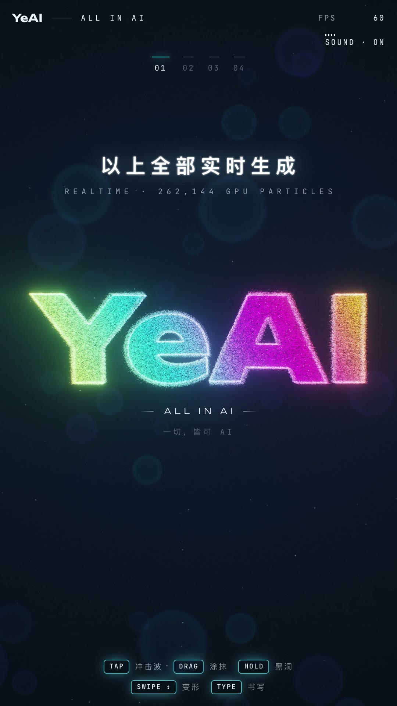

# YeAI · All in AI

一个在浏览器里实时运行的 GPU 粒子交互体验：26 万个粒子组成「YeAI」，对触碰、冲击波、黑洞、变形和书写作出反应。

**在线体验 → https://linzy874.github.io/yeai-all-in-ai/**（手机、电脑均可，建议开启声音）

<p align="center"></p>

## 怎么玩

| 操作 | 电脑 | 手机 |
|---|---|---|
| 拨动粒子 | 移动鼠标 | — |
| 涂抹 | 按住拖动 | 手指拖动 |
| 冲击波 | 单击 | 轻点 |
| 黑洞 → 超新星 | 长按后松开 | 长按后松开 |
| 变形（YeAI / All in AI / 神经网络球 / ∞） | 滚轮或方向键 | 上下快速划动，或点顶部 01–04 |
| 书写任意文字（支持中文） | 直接打字，Enter 引爆，Esc 返回 | 点底部「TYPE 书写」唤起键盘 |

彩蛋：输入 `yeai`，或者把所有操作都试一遍。

## 技术

- 单个 `index.html`，原生 WebGL2，无任何框架或构建步骤
- 粒子物理在 GPU 上用 Transform Feedback 计算（弹簧、无散度湍流、鼠标力场、冲击波、黑洞引力）
- HDR 渲染：运动拖尾、双重滤波 Bloom、变形光晕、色差、冲击波折射、ACES 色调映射
- 文字用 Canvas 栅格化后采样为粒子目标；输入的文字用加权一致性哈希分配粒子，新增字母时已有字形保持稳定
- Web Audio 实时合成全部音效
- 根据帧率自动调整分辨率和粒子数

## 本地运行

任意静态服务器即可，例如：

```bash
npx serve .
```

## 导出展示视频

`tools/render-video.mjs` 会用无头浏览器以 `?capture=1` 模式逐帧渲染脚本化的镜头，并离线合成同步音轨，输出 1080×1920 / 60fps 的 MP4（需要 Node、ffmpeg、puppeteer 和一个 Chromium 内核浏览器）：

```bash
node tools/render-video.mjs
```
